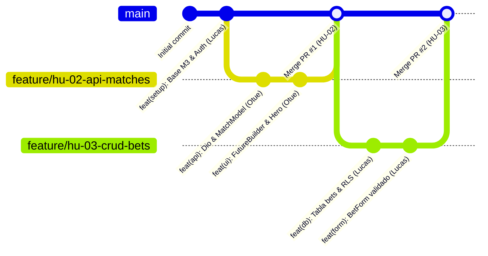

# 🏐 VolleyBet — MVP & Evaluación UDD

> Aplicación móvil y web de apuestas deportivas virtuales y gamificadas de voleibol con estética Anime Material 3, arquitectura limpia en 3 capas y backend serverless en Supabase.

Proyecto desarrollado para la asignatura **IIP323W (Programación Móvil con Flutter)** — **Universidad del Desarrollo (UDD)**.

---

## 👥 Equipo y Asignación de Roles

| Integrante | Rol en el Proyecto | Historias de Usuario Asignadas |
|---|---|---|
| **Lucas Riquelme** | **Persona 1:** Lead Backend, Base de Datos & Setup | **HU-01:** Setup, Tema M3, Supabase Auth & AuthGate<br>**HU-03:** Formulario con Validación & Tabla Supabase RLS (CRUD) |
| **Otue** | **Persona 2:** Lead UI, API Externa & Navegación | **HU-02:** Consumo API deportiva (`dio`), `FutureBuilder` & `Hero`<br>**HU-05 (Parte A):** Animaciones Implícitas & Widgets modulares |
| **Jesús** | **Persona 3:** Estado Global, Simulación & Gamificación | **HU-04:** Manejo de estado con `Provider` & Motor de Simulación<br>**HU-05 (Parte B):** Modo Aprender (Trivia), Ranking & Build Web |

---

## 🚀 Puesta en Marcha Rápida (Comandos)

Sigue estos pasos para clonar, configurar y ejecutar el proyecto en tu máquina local:

### 1. Prerrequisitos
* **Flutter SDK:** versión `>= 3.19.0` ([Instrucciones de instalación](https://docs.flutter.dev/get-started/install)).
* **Dart SDK:** incluido con Flutter.
* **Google Chrome** (para probar en Web) o **Emulador Android / Dispositivo físico**.

### 2. Clonar e Instalar Dependencias
```bash
# 1. Clonar el repositorio
git clone <URL_DEL_REPOSITORIO>
cd VolleyBet

# 2. Configurar variables de entorno
cp .env.example .env
```

> [!IMPORTANT]
> Edita el archivo `.env` recién creado y define las credenciales públicas de Supabase (URL y Anon Key). Consulta los valores de referencia en [`docs/SUPABASE_CONFIG.md`](docs/SUPABASE_CONFIG.md). Nunca agregues credenciales secretas (service_role) en este archivo.

```bash
# 3. Descargar paquetes de Flutter
flutter pub get

# 4. Verificar integridad del código (debe reportar 0 errores)
flutter analyze

# 5. Ejecutar la suite de pruebas automatizadas (10/10 tests deben pasar)
flutter test
```

### 3. Ejecutar la Aplicación
```bash
# Para ejecutar en el navegador Web (Recomendado para pruebas rápidas)
flutter run -d chrome

# Para ejecutar en emulador o dispositivo móvil conectado
flutter run
```

---

## 🔑 Cuentas de Acceso Rápido (Demo & Evaluación)

Para facilitar la evaluación docente sin tener que escribir correos ni contraseñas manualmente, la pantalla de Login incluye **botones de acceso rápido de un toque** para los 3 integrantes:

* 👤 **Lucas:** `lucas@volleybet.udd` (Saldo inicial: 1,000 pts)
* 👤 **Otue:** `otue@volleybet.udd` (Saldo inicial: 1,000 pts)
* 👤 **Jesús:** `jesus@volleybet.udd` (Saldo inicial: 1,000 pts)

---

## 🏛️ Arquitectura del Proyecto (3 Capas)

El código fuente en `lib/` está estrictamente organizado respetando la arquitectura requerida:

```text
lib/
├── main.dart                 # Punto de entrada, carga de .env y MaterialApp
├── theme/
│   └── app_theme.dart        # Tema Anime Material 3 (Colores #1B1F29, #262B38, #FF6A1A)
├── models/                   # Capa 1: Entidades tipadas con serialización fromJson
│   ├── user_profile.dart     # Modelo de usuario, saldo y badges
│   └── match_model.dart      # (HU-02) Modelo de partidos y cuotas colectivas
├── services/                 # Capa 2: Servicios de red, API y persistencia externa
│   ├── supabase_service.dart # Singleton y cliente Supabase Auth / Database
│   └── sports_api_service.dart # (HU-02) Consumo de API deportiva con Dio
├── screens/                  # Capa 3: Vistas completas de usuario
│   ├── auth/
│   │   ├── auth_gate.dart    # Guardián reactivo de sesión (StreamBuilder)
│   │   └── login_screen.dart # Formulario con accesos rápidos de equipo
│   ├── home/
│   │   └── home_screen.dart  # Pantalla principal protegida y saldo de puntos
│   ├── matches/              # (HU-02) Cartelera y detalle de partido con Hero
│   ├── bets/                 # (HU-03) Formulario y CRUD de historial con RLS
│   ├── simulation/           # (HU-04) Motor acelerado de partidos
│   └── learn/                # (HU-05) Modo Aprender / Trivia
├── widgets/                  # Componentes reutilizables modulares propios
│   ├── match_card.dart       # Tarjeta de partido
│   └── odds_button.dart      # Botón de cuota animado con AnimatedScale
└── providers/                # Gestión de estado global con Provider
    └── points_provider.dart  # Saldo reactivo compartido en toda la app
```

---

## 🌿 Flujo de Trabajo con Ramas Git (Git Workflow)

Para asegurar un historial de commits balanceado y ordenado para la evaluación docente en GitHub (*Insights > Contributors*), trabajaremos bajo la estrategia de **Feature Branches**:



### Reglas del Flujo de Trabajo:
1. **La rama `main` es sagrada:** Contiene siempre código funcional, probado con `flutter test` y con `flutter analyze` en 0 errores.
2. **Cada historia se desarrolla en su propia rama:**
   * Otue: `feature/hu-02-api-matches`
   * Lucas: `feature/hu-03-crud-bets`
   * Jesús: `feature/hu-04-provider-simulation`
   * Otue & Jesús: `feature/hu-05-gamification-ranking`

### Paso a Paso para cada Integrante:

```bash
# 1. Asegurarse de tener la última versión de main
git checkout main
git pull origin main

# 2. Crear y cambiar a la rama de tu historia
git checkout -b feature/hu-0X-nombre-descriptivo

# 3. Trabajar en el código de tu historia y hacer commits atómicos
# (¡Recuerda que tus commits deben estar a tu nombre en Git!)
git add .
git commit -m "feat(modulo): descripción clara de lo implementado"

# 4. Antes de subir o hacer merge, verificar calidad técnica:
flutter analyze   # 0 advertencias
flutter test      # todos los tests pasando

# 5. Mantener tu rama al día con main para evitar conflictos:
git fetch origin
git merge origin/main

# 6. Subir tu rama a GitHub:
git push -u origin feature/hu-0X-nombre-descriptivo

# 7. Crear un Pull Request (PR) en GitHub hacia main:
# - Pedir revisión a un compañero de equipo.
# - Una vez aprobado, hacer el merge hacia main.
```

---

## 📚 Documentación de Contexto (Para Humanos y Agentes IA)

Si tú o tus compañeros utilizan asistentes de IA (Antigravity, Cursor, Claude Code, Copilot, ChatGPT), el repositorio cuenta con documentación estructurada que le da el 100% del contexto del proyecto sin alucinaciones:

* 📋 **Historias de Usuario y Pauta UDD:** [`docs/HISTORIAS_DE_USUARIO.md`](docs/HISTORIAS_DE_USUARIO.md) — Desglose Gherkin de las 5 historias y los 9 requisitos de evaluación.
* 📐 **Especificación Técnica Completa:** [`_bmad-output/specs/spec-volleybet/SPEC.md`](_bmad-output/specs/spec-volleybet/SPEC.md) — Definición de capacidades y reglas de negocio.
* 🗺️ **Desglose de Épicas del MVP:** [`_bmad-output/planning-artifacts/epics.md`](_bmad-output/planning-artifacts/epics.md) — Tareas técnicas y arquitectura.
* 🚦 **Estado del Sprint:** [`_bmad-output/implementation-artifacts/sprint-status.yaml`](_bmad-output/implementation-artifacts/sprint-status.yaml) — Estado de cada historia (`backlog`, `in-progress`, `review`, `done`).
* 🔒 **Configuración de Supabase:** [`docs/SUPABASE_CONFIG.md`](docs/SUPABASE_CONFIG.md) — Endpoints y tablas de la base de datos.