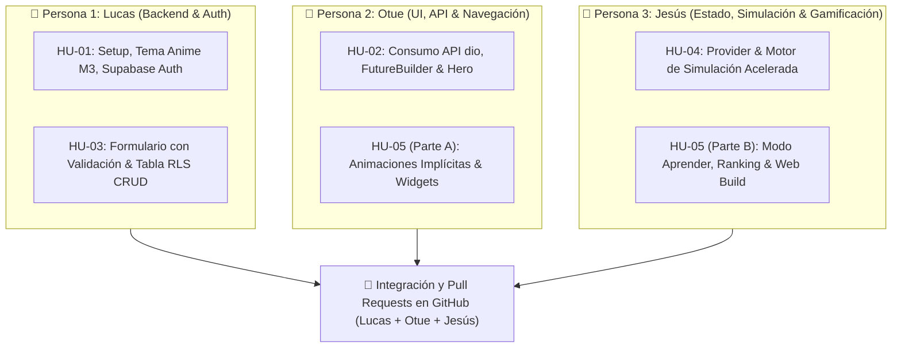
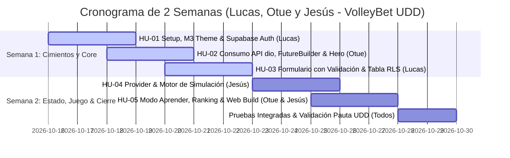

# VolleyBet — Documento Maestro de Historias de Usuario (Backlog del Proyecto)

> **Proyecto:** VolleyBet (MVP 2 Semanas)  
> **Curso:** IIP323W Desarrollo de Aplicaciones Móviles (Flutter) — Universidad del Desarrollo (UDD)  
> **Profesor:** Cristóbal Maturana  
> **Equipo (3 Integrantes):**  
> - **Persona 1:** Lucas (Lead Backend, Autenticación y Persistencia)  
> - **Persona 2:** Otue (Lead UI, Consumo de API y Navegación)  
> - **Persona 3:** Jesús (Lead Estado Global, Simulación y Gamificación)  
> **Stack:** Flutter (Dart) + Android Studio + Supabase (Auth, Postgres, RLS) + dio + Provider + Despliegue Flutter Web (Vercel)  
> **Última Actualización:** 15 de Octubre de 2026

---

## 📌 Tabla de Alineación con la Pauta Docente (9 Requisitos Obligatorios)

Para asegurar la nota máxima en la Unidad 2, cada historia de usuario atiende directamente a uno o más de los 9 requisitos mínimos:

| # | Requisito Exigido por el Profesor | Historia de Usuario | Responsable Principal | Cómo se Evidencia en el Código |
|---|---|---|---|---|
| **1** | **Login con Supabase** (`AuthGate`, registrarse, entrar, salir) | **HU-01** | **Lucas** | `AuthGate`, `SupabaseAuth`, pantallas de login y registro. |
| **2** | **Datos de API Deportiva con `FutureBuilder`** | **HU-02** | **Otue** | `dio` + `FutureBuilder<List<MatchModel>>` con 3 estados. |
| **3** | **Navegación al Detalle por Constructor** | **HU-02** | **Otue** | `Navigator.push(..., MatchDetailScreen(match: match))`. |
| **4** | **Animaciones (Hero + Animación Implícita)** | **HU-02** & **HU-05** | **Otue** (Hero) / **Otue y Jesús** (Implícita) | `Hero` en escudos y `AnimatedScale`/`AnimatedContainer`. |
| **5** | **Tabla en Supabase con RLS (CRUD Completo)** | **HU-03** | **Lucas** | Tabla `bets` con RLS (`auth.uid() = user_id`) y CRUD. |
| **6** | **Formulario con Validación (`Form` + `TextFormField`)** | **HU-03** | **Lucas** | `Form`, `GlobalKey<FormState>()`, `validator` de monto y saldo. |
| **7** | **Estado Compartido con `Provider`** | **HU-04** | **Jesús** | `ChangeNotifier` (`BettingProvider`), `MultiProvider`, `context.watch`. |
| **8** | **Widgets Propios en Archivos Separados** | **HU-02**, **HU-03**, **HU-05** | **Lucas, Otue y Jesús** | Componentes modulares extraídos en `lib/widgets/`. |
| **9** | **GitHub con Commits de los 3 Integrantes** | **Transversal** | **Lucas, Otue y Jesús** | Commits y PRs equilibrados de los 3 en GitHub + build Web. |

---

## 👥 Matriz de Distribución de Trabajo (Lucas, Otue y Jesús)

Para cumplir estrictamente con el **Requisito 9** (commits verificables de los 3 integrantes):



---

## 📖 Especificación Detallada de Historias de Usuario

---

### 🔹 Historia de Usuario 1: Setup Inicial, Tema Anime M3, Supabase Auth y AuthGate
* **Identificador:** `HU-01` (`1-1-setup-inicial-de-flutter-tema-anime-m3-supabase-auth-y-authg`)
* **Requisito Docente:** **Requisito 1** (Login Supabase, `AuthGate`, registrarse, entrar, salir).
* **Capacidades Vinculadas:** Fundamento transversal, `CAP-1` a `CAP-5`.
* **Estimación / Complejidad:** Media (2-3 días).
* **Responsable Asignado:** **Lucas** (Persona 1 - Lead Backend & Setup).

#### 1. Descripción
**Como** estudiante o evaluador de VolleyBet,  
**Quiero** autenticarme en la aplicación mediante Supabase o seleccionar rápidamente uno de los 3 perfiles del equipo (Lucas, Otue o Jesús),  
**Para** acceder de manera segura a la experiencia gamificada protegida con el tema visual Anime Material 3.

#### 2. Criterios de Aceptación (Gherkin)
- **Criterio 1.1 (Protección con AuthGate):**  
  **Given** la aplicación recién abierta y sin una sesión persistida,  
  **When** se carga la pantalla inicial,  
  **Then** el widget `AuthGate` intercepta el flujo y redirige a `LoginScreen`.
- **Criterio 1.2 (Autenticación Exitosa):**  
  **Given** un usuario en la pantalla de Login,  
  **When** ingresa credenciales válidas y presiona "Iniciar Sesión",  
  **Then** Supabase Auth genera la sesión JWT y el `AuthGate` transiciona automáticamente al Home/Menú Principal sin recargar la app.
- **Criterio 1.3 (Cierre de Sesión):**  
  **Given** un usuario autenticado en la aplicación,  
  **When** presiona el botón "Cerrar Sesión" en su perfil o AppBar,  
  **Then** se invoca `Supabase.instance.client.auth.signOut()`, la sesión se destruye y la interfaz vuelve de inmediato a `LoginScreen`.
- **Criterio 1.4 (Dirección de Arte Anime M3):**  
  **Given** cualquier pantalla de la app,  
  **Then** se visualiza la paleta oficial: fondo oscuro `#1B1F29`, tarjetas `#262B38`, acento naranja dinámico `#FF6A1A`, textos en alto contraste y componentes redondeados Material 3.
- **Criterio 1.5 (Perfiles Rápidos de Prueba para el Equipo):**  
  **Given** el entorno de evaluación con el profesor,  
  **When** se presiona el botón de acceso rápido,  
  **Then** se puede ingresar directamente con cualquiera de los 3 perfiles sembrados (Lucas, Otue o Jesús) sin necesidad de escribir manualmente contraseñas en la demo.

#### 3. Tareas Técnicas / Checklist de Desarrollo (Lucas)
- [ ] Inicializar proyecto Flutter con arquitectura en 3 capas (`lib/models/`, `lib/services/`, `lib/screens/`, `lib/widgets/`, `lib/providers/`).
- [ ] Agregar dependencias en `pubspec.yaml`: `supabase_flutter`, `google_fonts`.
- [ ] Configurar `AppTheme` con `ThemeData(useMaterial3: true, colorScheme: ...)` y colores del anime.
- [ ] Implementar `SupabaseService` para inicialización con `supabaseUrl` y `anonKey`.
- [ ] Construir `AuthGate` utilizando un `StreamBuilder` sobre `Supabase.instance.client.auth.onAuthStateChange`.
- [ ] Construir `LoginScreen` y `RegisterScreen` con campos estilizados y manejo de mensajes de error.
- [ ] Añadir selector rápido con los 3 perfiles (Lucas, Otue, Jesús) para pruebas ágiles.

#### 4. Archivos Clave a Crear
- `lib/main.dart`
- `lib/theme/app_theme.dart`
- `lib/services/supabase_service.dart`
- `lib/screens/auth/auth_gate.dart`
- `lib/screens/auth/login_screen.dart`
- `lib/screens/auth/register_screen.dart`

---

### 🔹 Historia de Usuario 2: Consumo de API Deportiva con dio, FutureBuilder y Detalle con Hero
* **Identificador:** `HU-02` (`1-2-consumo-de-api-deportiva-con-dio-futurebuilder-y-detalle-con`)
* **Requisitos Docentes:** **Requisito 2** (API deportiva con `FutureBuilder`, 3 estados), **Requisito 3** (Navegación al detalle por constructor), **Requisito 4** (Animación `Hero`), **Requisito 8** (Widgets en archivos separados).
* **Capacidades Vinculadas:** `CAP-2` (Cartelera de partidos y cuotas colectivas de equipo).
* **Estimación / Complejidad:** Media (2-3 días).
* **Responsable Asignado:** **Otue** (Persona 2 - Lead UI & API).

#### 1. Descripción
**Como** fanático del voleibol y apostador deportivo,  
**Quiero** visualizar una cartelera de partidos actualizados con sus cuotas de victoria y navegar al detalle de cada encuentro,  
**Para** analizar el enfrentamiento y elegir mi pronóstico viendo la transición animada del escudo del equipo.

#### 2. Criterios de Aceptación (Gherkin)
- **Criterio 2.1 (Manejo de los 3 Estados en FutureBuilder):**  
  **Given** la pantalla `MatchesScreen` consumiendo datos de partidos con `dio`,  
  **When** se abre la pantalla o se hace pull-to-refresh:  
  - Si la conexión está en progreso (`ConnectionState.waiting`), se muestra un `CircularProgressIndicator` centrado con estilo anime.  
  - Si ocurre una excepción o fallo de red (`snapshot.hasError`), se muestra un mensaje de error claro con un botón para "Reintentar".  
  - Si la carga es exitosa (`snapshot.hasData`), se renderiza una lista de tarjetas `MatchCard`.
- **Criterio 2.2 (Paso de Datos por Constructor):**  
  **Given** la lista de partidos en pantalla,  
  **When** el usuario toca sobre una tarjeta de partido,  
  **Then** la app ejecuta `Navigator.push` instanciando `MatchDetailScreen(match: selectedMatch)` pasando la entidad completa por constructor (sin usar variables globales ni rutas con parámetros mágicos).
- **Criterio 2.3 (Animación Hero en Escudos):**  
  **Given** el escudo del equipo local/visitante en la tarjeta `MatchCard` con tag único `Hero(tag: 'team-logo-${match.id}')`,  
  **When** se realiza la transición hacia `MatchDetailScreen`,  
  **Then** el escudo vuela y escala suavemente hacia la cabecera del detalle sin parpadeos ni cortes.
- **Criterio 2.4 (Modelado Exclusivo a Nivel de Equipo):**  
  **Given** las cuotas presentadas,  
  **Then** solo se muestran cuotas a ganador y marcador de sets por equipo (ej: Brasil 1.75 vs Polonia 2.10); no se exponen estadísticas individuales por atleta.

#### 3. Tareas Técnicas / Checklist de Desarrollo (Otue)
- [ ] Agregar dependencia `dio` en `pubspec.yaml`.
- [ ] Crear modelo `MatchModel` con atributos (`id`, `tournament`, `homeTeam`, `awayTeam`, `homeLogo`, `awayLogo`, `homeOdds`, `awayOdds`, `matchDate`, `status`) y método `factory MatchModel.fromJson(Map<String, dynamic> json)`.
- [ ] Crear `SportsApiService` usando `Dio` con método `Future<List<MatchModel>> getMatches()`.
- [ ] Implementar pantalla `MatchesScreen` con `FutureBuilder<List<MatchModel>>` validando explícitamente los 3 estados requeridos.
- [ ] Modularizar el componente `MatchCard` en `lib/widgets/match_card.dart`.
- [ ] Implementar animación `Hero` en el escudo del equipo entre la tarjeta y la pantalla de detalle.
- [ ] Implementar `MatchDetailScreen` recibiendo el parámetro `required MatchModel match` en el constructor.

#### 4. Archivos Clave a Crear
- `lib/models/match_model.dart`
- `lib/services/sports_api_service.dart`
- `lib/screens/matches/matches_screen.dart`
- `lib/screens/matches/match_detail_screen.dart`
- `lib/widgets/match_card.dart`
- `lib/widgets/odds_button.dart`

---

### 🔹 Historia de Usuario 3: Formulario con Validación y Tabla en Supabase con RLS (CRUD)
* **Identificador:** `HU-03` (`1-3-formulario-con-validacion-y-tabla-en-supabase-con-rls-crud`)
* **Requisitos Docentes:** **Requisito 5** (Tabla con RLS y CRUD completo), **Requisito 6** (Formulario con validación), **Requisito 8** (Widgets en archivos separados).
* **Capacidades Vinculadas:** `CAP-3` (Colocación y resolución de pronósticos deportivos).
* **Estimación / Complejidad:** Alta (3 días).
* **Responsable Asignado:** **Lucas** (Persona 1 - Lead Backend & Base de Datos).

#### 1. Descripción
**Como** usuario autenticado de VolleyBet (Lucas, Otue o Jesús),  
**Quiero** ingresar el monto de mi apuesta mediante un formulario con validación estricta y gestionar mis pronósticos en mi historial,  
**Para** apostar mis puntos de forma segura sin vulnerar mi saldo y poder modificar o cancelar apuestas pendientes.

#### 2. Criterios de Aceptación (Gherkin)
- **Criterio 3.1 (Validación de Formulario Obligatoria):**  
  **Given** el formulario de apuesta `BetForm` con `GlobalKey<FormState>()`,  
  **When** el usuario intenta enviar la apuesta:  
  - Si el campo está vacío, el validador muestra *"Ingresa un monto"*.  
  - Si el monto es menor o igual a 0, el validador muestra *"El monto mínimo es 1 punto"*.  
  - Si el monto excede el saldo de puntos disponible, el validador muestra *"Saldo insuficiente (disponibles: X pts)"*.  
  - Solo si `formKey.currentState!.validate()` es `true`, se procede con el guardado en Supabase.
- **Criterio 3.2 (CREATE — Colocar Apuesta):**  
  **Given** un monto válido y un equipo seleccionado,  
  **When** se confirma el formulario,  
  **Then** se inserta un registro en la tabla `bets` con `user_id = auth.uid()`, `status = 'PENDING'`, y se descuenta el saldo correspondiente.
- **Criterio 3.3 (READ — Ver Historial con RLS):**  
  **Given** la pantalla `BetHistoryScreen`,  
  **When** Lucas, Otue o Jesús consulta sus apuestas,  
  **Then** gracias a la política RLS `create policy ... for select using (auth.uid() = user_id)`, cada integrante solo ve sus propias apuestas; es imposible ver las de otros usuarios.
- **Criterio 3.4 (UPDATE — Editar Apuesta Pendiente):**  
  **Given** una apuesta en estado `PENDING`,  
  **When** el usuario presiona "Modificar Apuesta" y cambia el monto a un valor válido,  
  **Then** el registro se actualiza en Supabase y el saldo de puntos se ajusta coherentemente con la diferencia.
- **Criterio 3.5 (DELETE — Cancelar Apuesta Pendiente):**  
  **Given** una apuesta en estado `PENDING`,  
  **When** el usuario presiona "Cancelar Apuesta" y confirma en el diálogo,  
  **Then** el registro se elimina de `bets` (o se marca `CANCELLED`) y el monto apostado es devuelto íntegramente al saldo del usuario.

#### 3. Tareas Técnicas / Checklist de Desarrollo (Lucas)
- [ ] Ejecutar el script SQL de creación de tabla `bets` y políticas RLS en la consola de Supabase:
  ```sql
  alter table public.bets enable row level security;
  create policy "Ver propias apuestas" on public.bets for select using (auth.uid() = user_id);
  create policy "Crear apuesta propia" on public.bets for insert with check (auth.uid() = user_id);
  create policy "Editar apuesta pendiente propia" on public.bets for update using (auth.uid() = user_id);
  create policy "Eliminar apuesta pendiente propia" on public.bets for delete using (auth.uid() = user_id);
  ```
- [ ] Crear modelo `BetModel` con soporte para serialización y estados (`PENDING`, `WON`, `LOST`, `CANCELLED`).
- [ ] Crear componente `BetForm` en `lib/widgets/bet_form.dart` usando `Form`, `TextFormField`, teclado numérico y validación en tiempo real.
- [ ] Implementar métodos en `SupabaseService`: `createBet()`, `getUserBets()`, `updateBetAmount()`, `cancelBet()`.
- [ ] Construir la pantalla `BetHistoryScreen` con pestañas para apuestas pendientes y finalizadas.

#### 4. Archivos Clave a Crear
- `lib/models/bet_model.dart`
- `lib/widgets/bet_form.dart`
- `lib/screens/bets/bet_history_screen.dart`
- `lib/widgets/bet_card.dart`

---

### 🔹 Historia de Usuario 4: Manejo de Estado con Provider y Motor de Simulación Acelerada
* **Identificador:** `HU-04` (`1-4-manejo-de-estado-con-provider-y-motor-de-simulacion-acelerad`)
* **Requisitos Docentes:** **Requisito 7** (Estado compartido con `Provider`: `ChangeNotifier`, `MultiProvider`, `context.watch<T>()` / `Consumer`).
* **Capacidades Vinculadas:** `CAP-3` (Resolución de pronósticos), `CAP-4` (Motor de simulación acelerada).
* **Estimación / Complejidad:** Alta (3 días).
* **Responsable Asignado:** **Jesús** (Persona 3 - Lead Estado & Lógica de Juego).

#### 1. Descripción
**Como** usuario o evaluador del proyecto,  
**Quiero** disparar la simulación acelerada del resultado de un partido y observar cómo mi saldo de puntos y estado de apuestas se actualizan automáticamente en toda la app sin recargar,  
**Para** verificar en menos de 5 minutos el ciclo completo de juego (apuesta -> partido -> liquidación -> cobro de premio).

#### 2. Criterios de Aceptación (Gherkin)
- **Criterio 4.1 (Centralización con MultiProvider):**  
  **Given** la raíz de la aplicación en `main.dart`,  
  **Then** se inyectan los proveedores de estado globales mediante `MultiProvider` envolviendo a `MaterialApp`.
- **Criterio 4.2 (Reactividad en el Saldo con notifyListeners):**  
  **Given** cualquier pantalla donde se muestre el saldo de puntos (AppBar, Perfil, Formulario),  
  **When** se descuentan puntos al apostar o se abonan puntos por victoria,  
  **Then** `BettingProvider` ejecuta `notifyListeners()` y los widgets suscritos mediante `context.watch<BettingProvider>()` o `Consumer<BettingProvider>` se redibujan de forma inmediata.
- **Criterio 4.3 (Motor de Simulación Acelerada):**  
  **Given** un partido con apuestas activas en estado `PENDING`,  
  **When** el evaluador o usuario presiona el botón "Simular Partido",  
  **Then** el sistema genera un marcador creíble de sets de voleibol (ej: 3-1 o 3-2), determina el equipo ganador y actualiza el estado del partido a `FINISHED`.
- **Criterio 4.4 (Liquidación Automática de Apuestas):**  
  **Given** el partido recién finalizado por la simulación,  
  **When** el proveedor procesa las apuestas asociadas a dicho encuentro:  
  - Las apuestas al equipo ganador cambian a `WON` y suman `monto * cuota` al saldo de Supabase y memoria.  
  - Las apuestas al equipo perdedor cambian a `LOST` con ganancia 0.  
  - Si el usuario acumula 3 aciertos consecutivos, se activa la insignia "Francotirador".

#### 3. Tareas Técnicas / Checklist de Desarrollo (Jesús)
- [ ] Agregar dependencias `provider` en `pubspec.yaml`.
- [ ] Crear clase `BettingProvider extends ChangeNotifier` que administre: `pointsBalance`, `activeBets`, `streakCount`, `isSimulating`.
- [ ] Envolver `MaterialApp` en `MultiProvider` en `main.dart` con `ChangeNotifierProvider(create: (_) => BettingProvider())`.
- [ ] Crear `PointsBadgeWidget` en `lib/widgets/points_badge.dart` que consuma el saldo usando `context.watch<BettingProvider>()`.
- [ ] Implementar `SimulationService` con lógica para resolución de sets y cálculo de cuotas ganadas.
- [ ] Conectar la simulación con `SupabaseService` para actualizar registros de apuestas y el saldo del usuario en `profiles`.

#### 4. Archivos Clave a Crear
- `lib/providers/betting_provider.dart`
- `lib/services/simulation_service.dart`
- `lib/widgets/points_badge.dart`
- `lib/widgets/simulation_control_dialog.dart`

---

### 🔹 Historia de Usuario 5: Modo Aprender, Ranking en Vivo, Animaciones Implícitas y Despliegue Web
* **Identificador:** `HU-05` (`1-5-modo-aprender-ranking-animaciones-implicitas-y-verificacion`)
* **Requisitos Docentes:** **Requisito 4** (Animación implícita con `AnimatedScale` o `AnimatedContainer`), **Requisito 8** (Widgets modulares), **Requisito 9** (Commits balanceados de los 3 integrantes y compilación Flutter Web).
* **Capacidades Vinculadas:** `CAP-1` (Modo Aprender con trivia e insignia junior), `CAP-5` (Ranking semanal/global e insignias).
* **Estimación / Complejidad:** Media (2-3 días).
* **Responsables Asignados:** **Otue y Jesús** (Colaboración Frontend, Microinteracciones y Despliegue).

#### 1. Descripción
**Como** nuevo usuario aficionado al deporte y jugador competitivo,  
**Quiero** completar la trivia del Modo Aprender para ganar mi bolsa inicial de puntos, consultar la tabla de posiciones frente a mis compañeros de grupo (Lucas, Otue y Jesús) y disfrutar de microinteracciones animadas,  
**Para** aprender las reglas del voleibol, competir por el primer lugar del ranking y acceder a la app desde la web en Vercel.

#### 2. Criterios de Aceptación (Gherkin)
- **Criterio 5.1 (Trivia del Modo Aprender e Insignia Junior):**  
  **Given** un usuario que nunca ha completado el tutorial,  
  **When** responde correctamente las preguntas interactivas de reglas básicas, sets y rotaciones en `TriviaScreen`,  
  **Then** recibe su bolsa inicial de 1,000 puntos y se desbloquea en Supabase la insignia "Experto Junior en Voleibol", bloqueando intentos futuros de repetir la trivia para farmear puntos.
- **Criterio 5.2 (Tabla de Posiciones / Ranking en Vivo):**  
  **Given** la pantalla `RankingScreen`,  
  **When** se abre la vista,  
  **Then** consulta la tabla `profiles` ordenando a los usuarios por `points_balance` de forma descendente, destacando visualmente la tarjeta del usuario actual y mostrando a Lucas, Otue y Jesús en el tablero.
- **Criterio 5.3 (Animaciones Implícitas en la Interfaz):**  
  **Given** los botones de selección de cuota y confirmación de apuesta,  
  **When** el usuario hace click o tap,  
  **Then** se activan animaciones implícitas usando `AnimatedScale` (efecto pulsación/rebote suave al presionar) y `AnimatedContainer` (cambio gradual de color al seleccionar).
- **Criterio 5.4 (Compilación y Despliegue Web):**  
  **Given** el comando `flutter build web --release`,  
  **When** se ejecuta en la terminal,  
  **Then** compila exitosamente sin errores de dependencias móviles nativas, listo para alojarse en Vercel o Firebase Hosting.
- **Criterio 5.5 (Verificación de Commits en GitHub):**  
  **Given** el repositorio git del proyecto,  
  **When** el profesor revisa la pestaña de *Insights / Contributors*,  
  **Then** se visualizan commits y pull requests significativos y equilibrados de Lucas, Otue y Jesús.

#### 3. Tareas Técnicas / Checklist de Desarrollo (Otue & Jesús)
- [ ] Diseñar el cuestionario interactivo de 5 preguntas sobre voleibol en `TriviaScreen` (Otue).
- [ ] Persistir la obtención de la insignia "Experto Junior" en el campo `badges` de `profiles` (Jesús).
- [ ] Construir `RankingScreen` con lista ordenada de perfiles y animación de posición (Jesús).
- [ ] Implementar `AnimatedOddsButton` usando `AnimatedScale` para feedback táctil instantáneo (Otue).
- [ ] Construir pantalla de perfil `ProfileScreen` mostrando el saldo y las 3 insignias (Junior, Francotirador, Líder) (Otue).
- [ ] Verificar compatibilidad web ejecutando `flutter build web` y resolver posibles advertencias (Jesús & Lucas).
- [ ] Auditar el historial de git para asegurar que Lucas, Otue y Jesús hayan realizado commits sustanciales (Lucas, Otue y Jesús).

#### 4. Archivos Clave a Crear
- `lib/screens/learn/trivia_screen.dart`
- `lib/screens/ranking/ranking_screen.dart`
- `lib/screens/profile/profile_screen.dart`
- `lib/widgets/animated_odds_button.dart`
- `lib/widgets/badge_tile.dart`
- `lib/widgets/ranking_row.dart`

---

## 📅 Hoja de Ruta Sugerida para las 2 Semanas de Sprint



---

## 🏁 Checklist Final de Auditoría Previa a la Entrega

Antes de entregar al profesor Cristóbal Maturana, Lucas, Otue y Jesús deben revisar juntos cada punto:

- [ ] **1. Login Supabase (Lucas):** ¿Funciona el registro, inicio de sesión, `AuthGate` y cierre de sesión?
- [ ] **2. FutureBuilder con dio (Otue):** ¿Se evidencian claramente los 3 estados (cargando, error con reintento y datos)?
- [ ] **3. Navegación por Constructor (Otue):** ¿`MatchDetailScreen` recibe el objeto `MatchModel` directamente en su constructor?
- [ ] **4. Animaciones (Otue & Jesús):** ¿El escudo del equipo vuela con `Hero`? ¿Los botones usan `AnimatedScale` o `AnimatedContainer`?
- [ ] **5. Tabla RLS CRUD (Lucas):** ¿La tabla `bets` permite Crear, Ver, Editar monto y Cancelar bajo RLS?
- [ ] **6. Formulario con Validación (Lucas):** ¿El `Form` bloquea montos vacíos, negativos o superiores al saldo?
- [ ] **7. Provider (Jesús):** ¿El saldo de puntos se actualiza en vivo en el AppBar y Perfil al apostar o simular?
- [ ] **8. Widgets Separados (Todos):** ¿Están los componentes reutilizables extraídos en `lib/widgets/`?
- [ ] **9. Commits en GitHub (Lucas, Otue y Jesús):** ¿Los 3 integrantes tienen commits visibles y balanceados en el historial de `git log`?
- [ ] **10. Flutter Web (Todos):** ¿Compila limpiamente con `flutter build web`?
